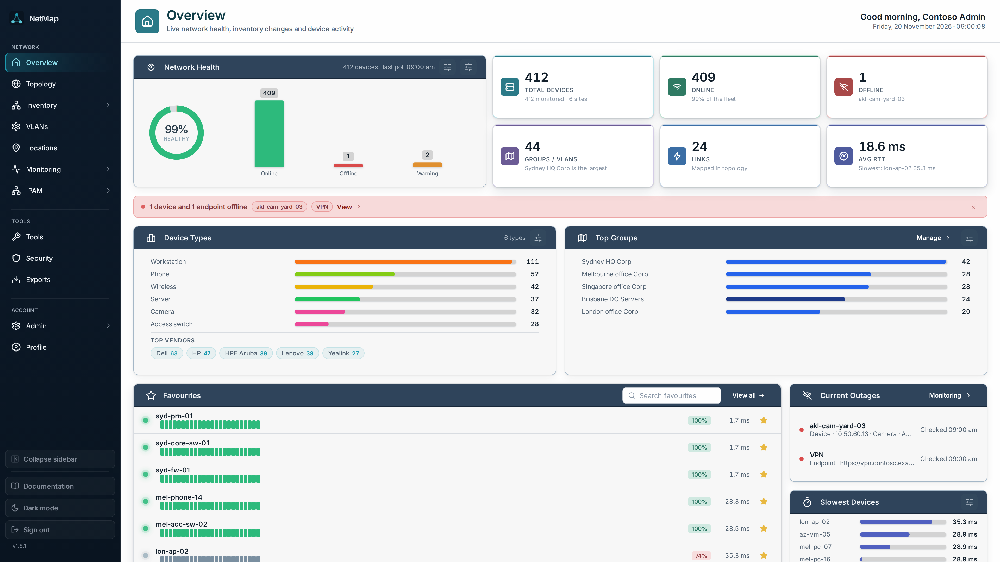

# NetMap

NetMap is a self-hosted application for network inventory, topology, monitoring, IP address management, discovery, syslog, alerting, and administration. You run it as a single Docker image on infrastructure you control.

This is the documentation home. If you are evaluating NetMap, start with [What Is NetMap](./product-introduction/what-is-netmap.md). If you want to run it now, go to [Quick Start](./installation/quick-start.md). The version you are running is shown on the **System** tab in Admin.

<figure>
  <picture>
    <source srcset=".gitbook/assets/screenshots/use-netmap/overview/overview-dark.png" media="(prefers-color-scheme: dark)" />
    
  </picture>
  <figcaption>Overview for Contoso Ltd, with 412 devices across Sydney HQ, the Melbourne, Singapore and London offices, the Auckland plant, and Brisbane DC. Current Outages shows akl-cam-yard-03.contoso.local.</figcaption>
</figure>

## Start Here

<table data-view="cards">
  <thead>
    <tr>
      <th></th>
      <th></th>
      <th data-hidden data-card-target data-type="content-ref"></th>
    </tr>
  </thead>
  <tbody>
    <tr>
      <td><strong>What Is NetMap?</strong></td>
      <td>What it is for, who it suits, and where it is not the right tool.</td>
      <td><a href="./product-introduction/what-is-netmap.md">what-is-netmap</a></td>
    </tr>
    <tr>
      <td><strong>Quick Start</strong></td>
      <td>Start the published image with Docker Compose and create the first administrator.</td>
      <td><a href="./installation/quick-start.md">quick-start</a></td>
    </tr>
    <tr>
      <td><strong>Interface Tour</strong></td>
      <td>The workspaces you will use after you sign in.</td>
      <td><a href="./using-netmap/interface-overview.md">interface-overview</a></td>
    </tr>
    <tr>
      <td><strong>API Quick Start</strong></td>
      <td>Create an API key and make your first request.</td>
      <td><a href="./api/quick-start.md">api-quick-start</a></td>
    </tr>
  </tbody>
</table>


Do not expose the initial setup page directly to the public internet. Put NetMap behind an HTTPS reverse proxy, or restrict the port with your firewall, before inviting users. See [Reverse Proxy And HTTPS](./installation/reverse-proxy.md).


## Install And Operate

<table data-view="cards">
  <thead>
    <tr>
      <th></th>
      <th></th>
      <th data-hidden data-card-target data-type="content-ref"></th>
    </tr>
  </thead>
  <tbody>
    <tr>
      <td><strong>Docker Compose</strong></td>
      <td>Ports, host networking, capabilities, and a production-shaped Compose file.</td>
      <td><a href="./installation/docker-compose.md">docker-compose</a></td>
    </tr>
    <tr>
      <td><strong>Reverse Proxy And HTTPS</strong></td>
      <td>Put NetMap behind TLS and set the public URL, origins, and cookies.</td>
      <td><a href="./installation/reverse-proxy.md">reverse-proxy</a></td>
    </tr>
    <tr>
      <td><strong>Upgrading</strong></td>
      <td>Back up, pull the new image, and verify the installation.</td>
      <td><a href="./installation/upgrading.md">upgrading</a></td>
    </tr>
    <tr>
      <td><strong>Backup And Restore</strong></td>
      <td>Protect the data directory and restore a backup.</td>
      <td><a href="./operations/backup-and-restore.md">backup-and-restore</a></td>
    </tr>
  </tbody>
</table>

## Use The Product

<table data-view="cards">
  <thead>
    <tr>
      <th></th>
      <th></th>
      <th data-hidden data-card-target data-type="content-ref"></th>
    </tr>
  </thead>
  <tbody>
    <tr>
      <td><strong>Topology</strong></td>
      <td>Map devices and sites, and save a layout your team can share.</td>
      <td><a href="./using-netmap/topology.md">topology</a></td>
    </tr>
    <tr>
      <td><strong>Monitoring</strong></td>
      <td>Watch device uptime, latency, and HTTP endpoints.</td>
      <td><a href="./using-netmap/monitoring.md">monitoring</a></td>
    </tr>
    <tr>
      <td><strong>IPAM</strong></td>
      <td>Manage subnets, reservations, DHCP leases, and public addresses.</td>
      <td><a href="./using-netmap/ipam.md">ipam</a></td>
    </tr>
    <tr>
      <td><strong>Run Discovery</strong></td>
      <td>Find hosts on your private network and review changes before you import them.</td>
      <td><a href="./guides/run-discovery.md">run-discovery</a></td>
    </tr>
  </tbody>
</table>

## Next Steps

- New to NetMap: [What Is NetMap](./product-introduction/what-is-netmap.md), then [Quick Start](./installation/quick-start.md).
- Already installed: [First-Run Setup And Authentication](./installation/first-run-and-authentication.md) and the [Interface Tour](./using-netmap/interface-overview.md).
- Something is not working: start with [Common Issues](./troubleshooting/common-issues.md). Remove credentials, private addresses, database contents, and raw syslog data before you share logs.


[Quick Start](./installation/quick-start.md)



[What Is NetMap](./product-introduction/what-is-netmap.md)

