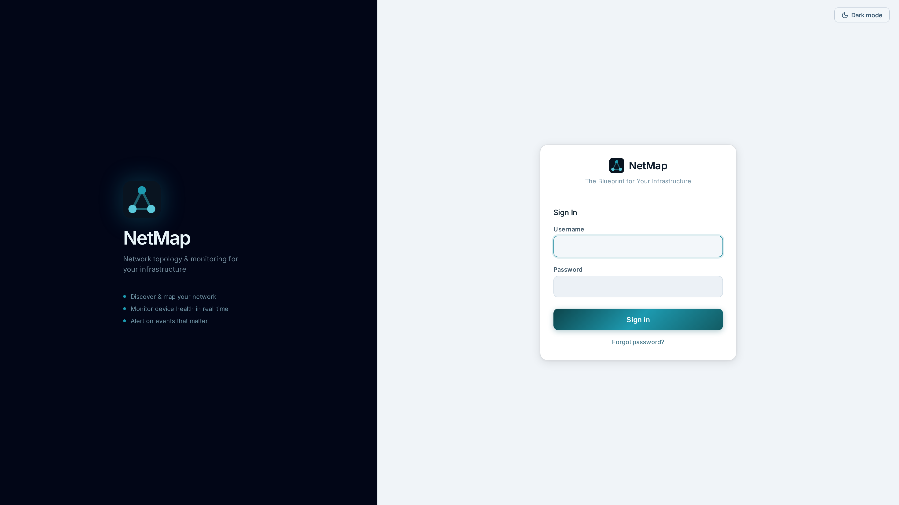

# First-Run Setup And Authentication

This page covers the browser authentication lifecycle after the container is healthy. The first account created through setup becomes the initial SuperAdmin; later users and roles are managed from Admin.

## First-Run Setup

The setup screen appears while the application has no users. The API reports this state through `GET /api/v1/setup/status` as `{ "needs_setup": true }`. Complete setup before exposing the service to other users.

1. Open the NetMap URL.
2. Enter the initial username and a long unique password.
3. Submit the form once and wait for the session to be established.
4. Confirm that Admin is visible and that the account is a SuperAdmin.

Setup is not a general user-registration flow. After the first account exists, new users must be created by an authorized administrator.

## First-Login Checklist

After signing in as the initial SuperAdmin:

1. Confirm `APP_URL`, trusted hosts, CORS origins, and secure-cookie settings.
2. Replace any temporary announcement or support settings.
3. Review Admin → Users and create only the accounts required for the deployment.
4. Review roles and permissions; use a dedicated least-privilege account for automation.
5. Confirm the persistent data directory and create a backup.
6. Add a test device and run a safe monitoring check.
7. Configure syslog, notifications, discovery, and SSO only when each is required.
8. Create API keys from Profile only for server-side automation, then store each plaintext key immediately.

## Local Sign-In And Sign-Out

Login branding uses a brief text-reveal entrance. Your system’s Reduce motion preference disables the animation and shows the text immediately. The sign-in fields remain available while the animation plays.

<figure>
  <picture>
    <source srcset="../.gitbook/assets/screenshots/get-started/sign-in-dark.png" media="(prefers-color-scheme: dark)">
    
  </picture>
  <figcaption>The NetMap sign-in screen.</figcaption>
</figure>

Local sign-in uses the username and password created during setup or by an administrator. The browser receives a short-lived access token in application memory and a refresh token in an HttpOnly cookie. The access token is not stored in localStorage.

Use the Sign out control to revoke the current refresh session. If the access token expires while the browser is idle, NetMap attempts a refresh; a failed refresh returns the browser to the login screen with "Session expired. Sign in again."

## Sessions

Each sign-in is its own session, so signing out ends only that browser or device. NetMap ends sessions automatically when:

| Event | Sessions ended |
|---|---|
| You change your password or two-factor settings | Your other sessions; this one stays signed in |
| An administrator changes your role, status, password or two-factor | All of your sessions |
| An old refresh token is reused | That sign-in's whole session |

`POST /api/v1/auth/logout-all` signs you out everywhere at once, and `DELETE /api/v1/auth/users/{user_id}/sessions` does the same for another user. API keys are not affected; revoke them separately.

## Session Lifetime And Idle Timeout

Defaults are:

| Setting | Default | Meaning |
| --- | ---: | --- |
| `ACCESS_TOKEN_MINUTES` | 60 | Access-token lifetime. |
| `REFRESH_TOKEN_DAYS` | 7 | Refresh-token lifetime. |

The SPA proactively refreshes the access token before its one-hour expiry. Reloading the page does not expose the refresh token to JavaScript.

Inactivity logout is optional and is set under **Admin → System**. With **Log out inactive users** turned off — the default on new installations from 1.7.0 — users stay signed in until they sign out, their refresh session expires, their password changes, or an administrator revokes the session. Turn it on and set **Idle session timeout (minutes)** (1–480) to sign users out after that long without mouse, keyboard, touch, or scroll activity in NetMap. Installations upgraded from an earlier release keep the timeout they already had, which was 15 minutes unless changed.

## Forgot And Reset Password

Use **Forgot password** on the login screen and enter the account email. The response does not reveal whether an account exists. If SMTP is configured, NetMap sends a time-limited reset link based on `APP_URL`.

Reset links are single-use and expire after one hour. Open the link, enter the new password, and sign in again. A successful reset revokes the user's existing refresh sessions. If email is unavailable, a SuperAdmin can reset a user's password from Admin → Users.

Relevant endpoints:

- `POST /api/v1/auth/forgot-password`
- `POST /api/v1/auth/reset-password`
- `POST /api/v1/auth/users/{user_id}/reset-password`

Never paste reset tokens into tickets, screenshots, or chat. If a link is expired, request a new one rather than reusing it.

## Change Your Password

An authenticated user can change a local password from Profile. The current password is required. A wrong current password returns `401`; a successful change invalidates pending password-reset tokens and protects the account from stale reset links.

OIDC-only users may not have a local password to change; manage their credentials at the identity provider.

## Login Lockouts

Failed local sign-ins are throttled per username. The defaults are five failed attempts followed by a 15-minute lockout, with a short progressive delay during failed-login handling. Administrators can adjust `AUTH_MAX_FAILED_ATTEMPTS`, `AUTH_LOCKOUT_MINUTES`, and `AUTH_PROGRESSIVE_DELAY_SECONDS`.

IP-level throttling is enabled by default with a separate 50-failure threshold (`AUTH_IP_MAX_FAILED_ATTEMPTS`) so one account does not immediately lock users behind the same NAT. A SuperAdmin can unlock a user's account-level state from Admin → Users; the source-IP state expires after the configured lockout window. Do not repeatedly retry a locked account; verify the password or use the administrator recovery path.

## OIDC Single Sign-On

OIDC is an additional browser sign-in method, not a replacement for the emergency SuperAdmin local login. See [OIDC SSO](../configuration/oidc-sso.md) for provider setup, linking, role mapping, callback errors, and the Require SSO safeguard.

## Troubleshooting Checklist

- **Setup does not appear:** check whether a user already exists and confirm `GET /api/v1/setup/status`.
- **Login returns `401`:** verify the username, password, active state, and lockout status.
- **The session returns to login:** check refresh-cookie path/domain, HTTPS settings, `APP_URL`, and proxy `X-Forwarded-Proto`.
- **Reset email has a wrong link:** set `APP_URL` to the public URL and verify SMTP settings.
- **SSO callback fails:** verify the exact redirect URI, issuer, client ID, provider reachability, and browser cookie handling.
- **Admin is missing:** the account may not be SuperAdmin, or the session may be stale; sign out and back in after a role change.

See [Authentication Problems](../troubleshooting/authentication-problems.md) for recovery commands and proxy-specific checks.

## Related Pages

- [Installation Overview](./installation.md)
- [OIDC SSO](../configuration/oidc-sso.md)
- [Profile](../using-netmap/profile.md)
- [Administration](../administer/index.md)
- [API Authentication](../api/authentication.md)
- [Authentication Problems](../troubleshooting/authentication-problems.md)
