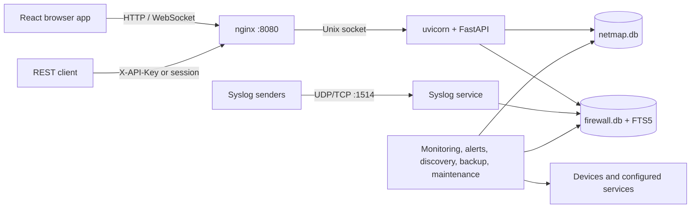

# How NetMap Works

This page explains how NetMap's parts fit together, what it needs from your network, and how to tell which version you're running.

## The All-In-One Image And Persistent Databases

The supported image runs nginx, the FastAPI application, the syslog listener and the background workers in one supervised container. nginx serves the browser app and passes `/api` and WebSocket traffic to the application over a local socket. Product routes live under `/api/v1`, and `/api/health` is the unauthenticated health check.

Browser sessions and API keys both resolve to a user, and that user's current role and permissions apply to every request. See [API Authentication](../api/authentication.md).

NetMap keeps its data in two SQLite databases under `/app/data`:

- `netmap.db` holds users, settings, devices, topology, monitoring, IPAM, alerts and audit data.
- `firewall.db` holds syslog and firewall events and their full-text search index.

The split stops a burst of syslog from slowing ordinary changes. Uploads and other persistent files also live under `/app/data`, so you need a durable volume and [backups](../operations/backup-and-restore.md) before production use.

The workers run inside the same process, with no separate queue. They handle monitoring checks, alerts and notifications, scheduled discovery, history clean-up and scheduled backups. If the container stops, all of these stop until it restarts.

### Start-Up And Recovery

At start-up NetMap checks the data directory and required secrets, prepares both databases and runs migrations, then starts its services. Invalid secrets or an unwritable data directory stop it from becoming healthy.

If the firewall search index is damaged, NetMap rebuilds it. If `firewall.db` itself is corrupt, NetMap recreates it, which loses stored firewall history but leaves `netmap.db` untouched. Check the container logs after an unexpected rebuild.

## Network Access And Capabilities

NetMap both listens for traffic and makes its own connections. It receives browser, API and syslog traffic, and it reaches out for discovery, monitoring, network tools, notifications, OIDC and update checks. [Ports](../reference/ports.md) lists the ports it listens on.

Syslog only arrives when you enable it and point your devices at NetMap. NetMap doesn't capture packets or find devices by watching traffic.

### Bridge Mode Or Host Networking

Docker's default bridge network is enough for most routed checks, but it hides the local network layer:

- ARP and MAC discovery doesn't cross the bridge, so scans may find IP addresses without MAC addresses.
- DHCP service checks may be ignored when the container's address is outside the served scope.
- Source-IP allow lists on remote devices see the container's translated address.

Use `network_mode: host` when you need these, after reviewing the larger exposure and removing any `ports:` mappings. Host networking doesn't bypass host or upstream firewalls.

### Capabilities

The image and example Compose files grant only what the network tools need: `NET_RAW`, permission to bind low ports, a capability on `ping`, and permission to run `nmap` as root. Without them, ping falls back to TCP checks, discovery may fail and DHCP checks may not bind their client port.

### Scan Scope

Discovery accepts private IPv4 and IPv6 ranges. By default, scans of more than 256 hosts need confirmation and scans of more than 1,024 hosts are refused; you can change both in the [Configuration Reference](../configuration/configuration.md). Only scan networks you're authorised to scan, start small and watch fragile devices. See [Run Discovery](../guides/run-discovery.md) and [Network Exposure](../security/network-exposure.md).

## Production Images And Installed Versions

Production images are published to Docker Hub as `xoriin/netmap` for `linux/amd64` and `linux/arm64`.

| Tag | Meaning | Use |
|---|---|---|
| `xoriin/netmap:<version>` | A specific release | Production pinning and rollback |
| `xoriin/netmap:latest` | The newest release | Convenience, if you pull and upgrade on purpose |
| `xoriin/netmap:test` | A build from the test branch | Testing only |

`latest` never updates a running container by itself, and pulling it later may give you a different image. Pin a version for change control.

The version NetMap shows in the sidebar and in **Admin** comes from a file baked into the image, so it always matches the image that's running. Test builds show a label such as `Test: <version>`.

When you view version status, NetMap compares your version with the newest release tag on GitHub and caches the answer for an hour. If GitHub can't be reached, NetMap carries on without update information. An update is never applied automatically; see [Upgrading](../installation/upgrading.md).

## Browser And Platform Support

Use a current desktop browser with JavaScript, cookies and site storage enabled. Chromium is tested automatically; current Firefox and Safari should work but aren't part of the automated tests, and Internet Explorer isn't supported.

Clearing site data signs you out and removes browser-only preferences and icon packs. Your inventory and layouts stay on the server.

NetMap adapts to small screens, but topology, dense tables, IPAM grids and admin forms work best on a desktop. There's no native mobile app. If a page is blank or controls fail, see [Common Issues](../troubleshooting/common-issues.md).
