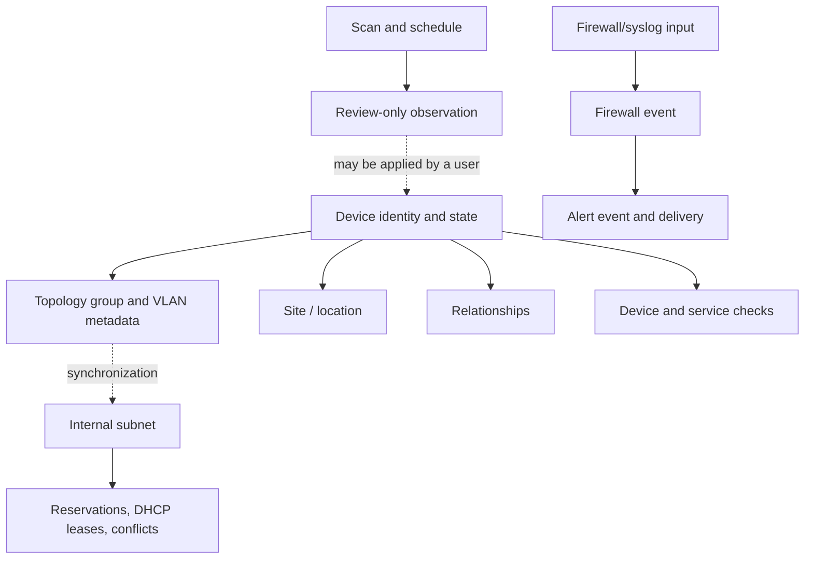
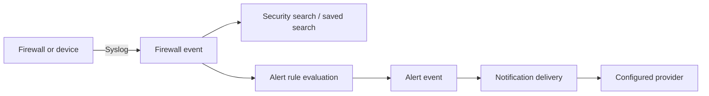

# Glossary

This page defines the terms NetMap uses and how its records relate. Each workspace page covers how to use them.

## Core Terms

| Term | Meaning |
|---|---|
| **Device** | A tracked network endpoint or infrastructure asset. A device may have an IP, MAC address, hostname, vendor, type, tags, notes, and topology membership. |
| **Identity** | The fields used to describe and match a device: IP, MAC, hostname, display name, vendor, operating system, and type. |
| **Relationship** | A directed or bidirectional topology link between devices. It can carry a type, notes, direction flags, and an optional manual link speed. |
| **Topology group** | A logical canvas container for devices. It can carry VLAN and subnet metadata and may be inferred from a device's group name. |
| **VLAN** | VLAN identifier and related network metadata stored with a topology group; it is not a switch configuration pushed by NetMap. |
| **Site / location** | A physical or logical place attached to devices and used for organization, filtering, and display. |
| **Subnet** | An internal IPv4 or IPv6 network range managed by IPAM. |
| **Reservation** | An IPAM record marking an address for a device or intended use. |
| **DHCP lease** | Imported lease information used as an IPAM data source; importing does not request, renew, or release a lease. |
| **Conflict** | An IPAM condition such as duplicate use, overlap, gateway collision, or reservation/DHCP inconsistency that needs review. |
| **Device check** | Reachability monitoring for an inventory device, with observed health and latency/history. |
| **Service check** | A device-associated TCP/UDP or protocol check. |
| **HTTP monitor** | A standalone HTTP/HTTPS endpoint monitor that is independent of an inventory device. |
| **Discovery scan** | An nmap operation against an authorized private target range. |
| **Schedule** | Configuration that runs discovery repeatedly and records its latest run. |
| **Observation** | A review-only finding produced by scheduled discovery; it does not silently change inventory. |
| **Firewall event** | A parsed or raw syslog record stored in the separate firewall database. |
| **Alert event** | A record that an alert rule fired. |
| **Notification delivery** | The attempt to send an alert through a configured target, recorded as sent or failed. |
| **Session** | Server-side authentication state associated with a browser or access token. |
| **API key** | A revocable secret authenticating REST requests as its owning user through `X-API-Key`. |

## How Records Relate

The dotted paths are conditional relationships, not automatic ownership. For example, a group may synchronize metadata to a canonical subnet, and a user may apply an observation to inventory after review.

## Device Records And State

| Field | Meaning |
|---|---|
| Display name | The label shown in the interface; it can differ from the hostname. |
| Hostname | The DNS or discovery name, kept separately from the display name. |
| IP address | A normalised IPv4 or IPv6 address. It identifies the device but doesn't prove it is reachable. |
| MAC address | The Layer 2 identity, when discovered or entered. MAC discovery needs suitable network access. |
| Vendor and operating system | Descriptive fields that aren't available for every device. |
| Device type | A built-in or custom classification such as router, switch, server or camera. |
| Tags and notes | Your own metadata. Tags are normalised and deduplicated. |

An empty hostname, MAC, vendor or OS field means the value is unknown, not that the device lacks it. Discovery can match a host by MAC, detect an IP move and raise an observation, but scheduled findings never change inventory until you apply them.

NetMap keeps four separate state concepts:

| Concept | Values | What it answers |
|---|---|---|
| Observed health | `healthy`, `unhealthy`, `unknown` or `paused`, after expected-status and lifecycle rules | What monitoring currently concludes |
| Expected status | `online` or `offline` | Should this device be reachable? |
| Lifecycle | `planned`, `active`, `retired` or `ignored` | Is this record part of the active fleet? |
| Monitoring paused | On or off | Is active monitoring suspended for now? |

An intentionally offline device can be healthy relative to its expectation, and a retired or paused device is never an outage. In the API, read the returned `health_status` rather than the raw `status` or `monitor_status` values.

## Topology

A **topology group** organises devices on the canvas and can carry a VLAN ID, subnet CIDR, gateway, DNS, description and colour. NetMap stores this as metadata; it never configures a switch, router, VLAN or DHCP server. When a device has a group name but no group assignment, the map can show inferred membership by name.

Group edits can sync metadata to one matching internal IPAM subnet. If several subnets match the group's CIDR and VLAN, the one already using that CIDR is chosen, so a DNS-only edit doesn't create a duplicate subnet.

A **site** is a physical or logical location with a name, optional display name, description, address and colour. Site membership is independent of group membership, and sites don't define reachability.

A **relationship** connects a source device to a target device. It can carry a free-form type, inbound and outbound direction flags, notes, and a manual link speed from 1 to 1,000,000 Mbps. Direction flags describe your model rather than inspected traffic, and link speed is entered by you, not measured. Deleting a relationship removes the edge but never deletes either device.

## Internal IPAM

| Record | Purpose |
|---|---|
| Subnet | An IPv4 or IPv6 CIDR with a name, description, gateway, DNS, VLAN and related metadata |
| Device address | An address on an inventory device, counted against matching subnets |
| Reservation | An address set aside for a device or purpose |
| DHCP lease | Imported lease data. Importing never contacts the DHCP server. |
| Conflict | A condition to review, such as duplicate use, overlapping subnets, a gateway collision or a reservation and lease mismatch |

Subnet membership is calculated numerically, so differently formatted addresses still count. In a subnet's address view, **free** means no tracked record claims the address; it doesn't guarantee that DHCP, a router or an untracked system won't use it. Deleting a subnet or reservation changes only NetMap, not external systems.

## External IPAM

External IPAM is a register of public addresses, separate from internal subnets. Each address has a status of in use, reserved or available, plus an optional purpose, owner, URL, tags, notes and Inventory device link. An address can sit in a **location**, such as a region or datacentre, and a location can belong to a **provider account** under a cloud or ISP **provider**. An address with no location is listed under **Unassigned**.

A **cloud asset** is a saved cloud resource, such as a server, load balancer or database, with an optional provider, account, region, description and Inventory device link. Releases before 1.7.0 used a deeper provider hierarchy, which upgrading flattens into this register. Validation rules are on [External IPAM](../using-netmap/external-ipam.md).

## Monitoring And Discovery

| Layer | Attached to | What it records |
|---|---|---|
| Device check | An inventory device | Reachability, expected status, health, latency and history |
| Service check | A device and a target port or protocol | Availability of that service |
| HTTP monitor | A URL, independent of inventory | Method, status range, assertions, TLS, authentication, proxy, retries and response history |

HTTP monitor secrets such as headers, bodies, tokens, proxy URLs, certificates and keys are encrypted and write-only. The API shows only whether each one is set.

A **scan** is one Nmap run with a target, scan type, status, counts and results. A **schedule** runs scans repeatedly and records the latest and next run. An **observation** compares scheduled results with inventory, as a new device, an IP move, changed fields or a disappeared host.

Observations never change inventory by themselves; you apply, resolve or leave each one. A disappeared-host observation needs three missed scheduled scans in a row, and a host that reappears can resolve it automatically. A ping sweep doesn't scan ports, and discovery only sees targets reachable from the container.

## Security Events And Notifications

A **firewall event** is parsed from an accepted syslog message. It can hold the event time, source and destination addresses and ports, protocol, action, interface, direction, rule IDs, reason and the original raw log, which is full-text searchable. Fields are empty when the sender doesn't provide them. A **saved search** stores your filters, not the event rows.

An **alert event** records that a rule fired. A **notification delivery** records one attempt to send it to a target, as `sent` or `failed` with a detail message, so a fired alert and a delivered notification are separate outcomes.

Firewall events are kept in `firewall.db`, separate from the main database. Retention permanently removes old events, but not provider-side copies or exported files.

## Related Pages

- [Inventory](../using-netmap/inventory.md)
- [Topology](../using-netmap/topology.md)
- [IPAM](../using-netmap/ipam.md)
- [Monitoring](../using-netmap/monitoring.md)
- [Security Events](../using-netmap/security-events.md)
- [Permissions](../administer/permissions.md)
- [Endpoint Reference](../api/reference/endpoints.md)
