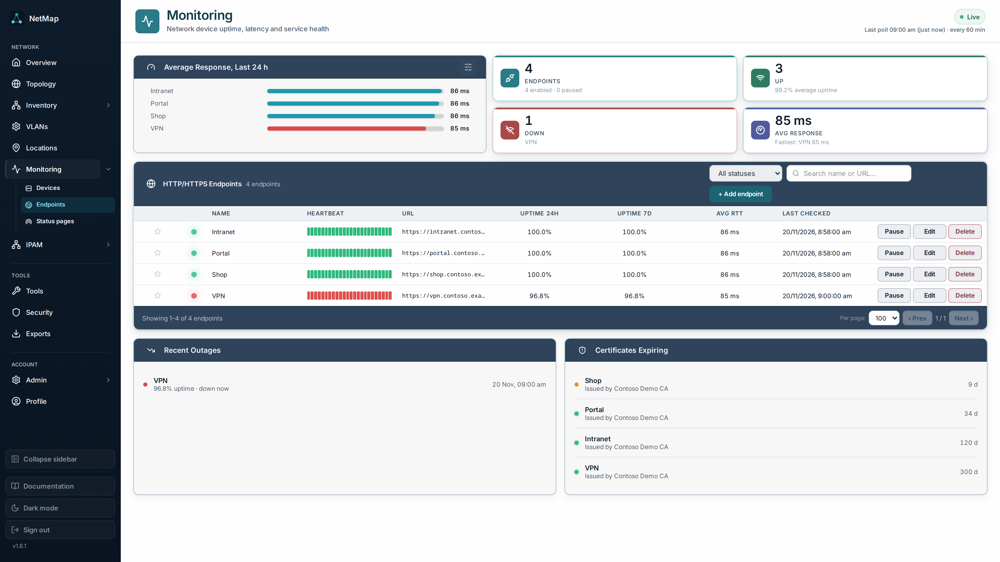

# HTTP Endpoint Monitors

Endpoint monitors check HTTP and HTTPS URLs on their own schedule, separately from devices. You find them under **Monitoring → Endpoints**, and you need `monitoring_write` to change them.

<figure>
  <picture>
    <source srcset="../.gitbook/assets/screenshots/use-netmap/endpoint-monitors/monitoring-endpoints-dark.png" media="(prefers-color-scheme: dark)">
    
  </picture>
  <figcaption>The Monitoring Endpoints view, with vpn.contoso.example Down.</figcaption>
</figure>

## Endpoints View

The **Endpoints** view opens with **Average Response, Last 24 h**, which ranks endpoints by average response time, beside the **Endpoints**, **Up**, **Down**, and **Avg response** cards. Below the list, **Recent Outages** shows up to five endpoints that are down or under 100% uptime in the last 24 hours. **Certificates Expiring** shows the five certificates that expire soonest, with the days left.

The endpoint list has a **Certificate** column for every HTTPS monitor: **Expired**, the days left (such as `34 d`), or **—** when no certificate has been seen yet. It shows as a warning once the days left reach the monitor's certificate warning threshold. Hover over it for the expiry date and issuer.

## Monitor Settings

Monitors have their own name, URL, interval, timeout, retry count/interval, enabled/paused state, tags, description, and upside-down mode (a failed request is healthy when failure is expected). Methods support redirect following, maximum redirects, cache busting, and request headers. Bodies may be JSON, form, plain text, or XML subject to the request method and size limits.

## Assertions And Authentication

Assertions include accepted status codes/ranges, required or forbidden keywords, and JSONPath operators/expected values. Authentication supports Basic, Bearer, OAuth 2.0 client credentials (token URL, client credentials, scopes, audience, auth method), and mutual TLS. Custom CAs, TLS verification, certificate issuer/expiry tracking, and an HTTP proxy are supported. Certificate issuer and expiry are recorded even when TLS verification is turned off.

## Secrets

Headers, bodies, passwords, tokens, proxy credentials/URLs, CA material, and client certificates/private keys are encrypted and write-only. Leave a secret field blank while editing to preserve it. Requests stream at most 2 MiB and do not log decrypted configuration or response bodies. Certificate expiry alerts require the monitor warning option plus the corresponding Admin alert rule.

## Endpoint History And Troubleshooting

Endpoint details show uptime, a zoomable [response-time chart](./monitoring.md#zoom-the-response-time-chart), heartbeat, recent HTTP status, response size, assertion diagnostics, and certificate issuer/expiry. A failure can be DNS/network, proxy, TLS, OAuth, mTLS, HTTP status, body/JSONPath assertion, timeout, or retry exhaustion; use the detailed result rather than treating every failure as “offline”.

| Symptom | Likely cause | Fix |
|---|---|---|
| endpoint TLS fails | untrusted CA, expired certificate, or verification mismatch | inspect issuer/expiry and configure a trusted CA or verification policy |
| endpoint assertion fails | status, keyword, or JSONPath condition is not met | inspect the assertion detail and correct the expected expression |

## Use The API

- `GET/POST/PATCH/DELETE /api/v1/monitors`
- `GET /api/v1/monitors/{monitor_id}/history`

## Related Pages

- [Monitoring](./monitoring.md)
- [Alerts](../administer/alerts.md)
- [Status Pages](./status-pages.md)
