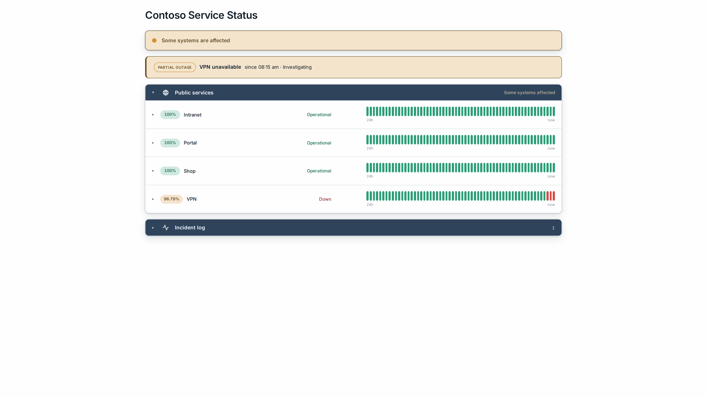

# Status Pages

A status page is a small, read-only web page that shows whether the things you choose are up, for the people who depend on your network rather than the people who run it. Each page lists devices, HTTP monitors and service checks in named groups, with an uptime figure and a heartbeat bar for each.

Status pages are managed from **Monitoring → Status pages**. The tab appears only if you have **Manage status pages** (`status_page_manage`), and anyone with it can edit every page.

<figure>
  <picture>
    <source srcset="../.gitbook/assets/screenshots/use-netmap/status-pages/status-page-public-dark.png" media="(prefers-color-scheme: dark)" />
    
  </picture>
  <figcaption>The public Contoso Service Status page.</figcaption>
</figure>

## The Status Pages Tab

The tab opens with an overview of every page:

- **Service Health Across Pages** is a ring of the services shown on your pages, split into Healthy, Degraded, Unavailable, Maintenance and No data. A service on several pages is counted once for each page.
- The **Status Pages** card counts pages as public and private, **Monitored services** shows how many are healthy, **Open incidents** shows the newest open incident, and **Maintenance** shows the next scheduled window.
- The **Status Pages** table lists each page's **Name**, **Address**, **Visibility**, **Heartbeat window** and when it was **Updated**, with **Edit** and **Delete**.
- **Incidents & Maintenance** lists the six most recent incidents and upcoming or active maintenance windows, with the page each belongs to.

## Create A Page

1. Open **Monitoring → Status pages** and choose **New status page**.
2. Enter a **name** and an **address** (the slug). The slug is 1 to 48 lowercase letters, digits or hyphens, and does not start or end with a hyphen. The page is served at `/status/<slug>` on your NetMap address.
3. Choose **Visibility**, then save.
4. In **Groups and items**, add groups and the items each group should show.
5. Use **Preview** to see the page exactly as visitors will see it.

### Public And Private

| Visibility | Who can open `/status/<slug>` |
|---|---|
| **Public**, anyone with the link | Anyone, with no sign-in. The page does not load NetMap's application or call the sign-in endpoints. |
| **Private**, signed-in users only | Any signed-in NetMap user, whatever their role. Without a session the visitor sees the sign-in screen and returns to the page afterwards. |

Public and Private pages are served from separate cached payloads. Switching a page from Public to Private, deleting it, or changing its slug removes the public copy immediately; an anonymous request for the old address then returns `404`, even with a previously valid `ETag`. Content a visitor has already downloaded cannot be recalled. An unknown slug and a Private page look the same to an anonymous visitor.

### Page Settings

| Setting | Notes |
|---|---|
| **Name** | The name shown in the editor list. |
| **Title** | Shown at the top of the page. Leave it empty to use the name. |
| **Logo** | A raster image checked the same way as the email logo. Use **Remove logo** to clear it. |
| **Accent colour** | A `#rrggbb` colour used for links and focus outlines. |
| **Heartbeat window** | **Last hour** (default) or **Last 24 hours**. |
| **Custom CSS** | See [Status Page Custom CSS](./status-page-css.md). |

Each editor tab shows a live preview beside its controls, using real monitoring data. Drafts aren't published until you select **Save settings** or **Save layout**, and **Discard changes** restores the saved version. Use **Refresh** to reload the preview after other changes.

## Groups And Items

Each page shows groups of devices, HTTP monitors and service checks, each under a display name you choose. States, the heartbeat bar, uptime and the optional extras are covered on [Status Page Groups And Items](./status-page-items.md).

## Incidents, Notices And Maintenance

Incidents, notices and scheduled maintenance tell visitors about problems and planned work. They are covered on [Status Page Incidents And Maintenance](./status-page-incidents.md).

## What Visitors Never See

A Public page's data is an explicit allow-list, not a filtered copy of internal data. It contains group names, display names, states, uptime figures, heartbeat slots, the extras you enabled, the page's own incidents with their public updates, notices and maintenance. It never contains IP addresses, hostnames, check URLs, raw errors, device or monitor IDs, item types, alert-rule names, usernames, internal updates, other pages' items, or any token or credential.

All text from people and integrations is shown as plain text, never HTML, and outbound links open with `rel="noopener noreferrer"`.

## Availability And Caching

Status pages are served from an in-memory snapshot, rebuilt whenever something changes and at least every 15 seconds, so heavy traffic can't slow NetMap. The browser polls every 30 seconds.

- A snapshot carries a `valid_until` deadline at most 30 seconds away. After it expires the server answers `503` with `Retry-After` rather than a stale green result, and the page shows the status as unavailable. The same happens if the browser cannot reach the server.
- On start-up, and while a page's first snapshot is being built, requests get `503` with `Retry-After: 5`.
- Public requests are rate-limited per client IP. Over the limit returns `429`.
- NetMap runs a single worker and holds a `status-pages.lock` file in its data directory. A second worker wouldn't serve status pages, so don't run several NetMap workers against one data directory.

## Integration Tokens

Outside systems, such as a backup server or deployment pipeline, can post notices, incidents and maintenance with page-scoped tokens created under **Integration tokens** in the editor. A token's name is shown publicly as the author of what it posts. See [Status Page Integrations](../api/guides/status-page-integrations.md).

## Related Pages

- [Status Page Groups And Items](./status-page-items.md)
- [Status Page Incidents And Maintenance](./status-page-incidents.md)
- [Status Page Custom CSS](./status-page-css.md)
- [Monitoring](./monitoring.md)
- [Permissions](../administer/permissions.md)
- [Status Page Integrations](../api/guides/status-page-integrations.md)
- [Rate Limits](../api/rate-limits.md)
