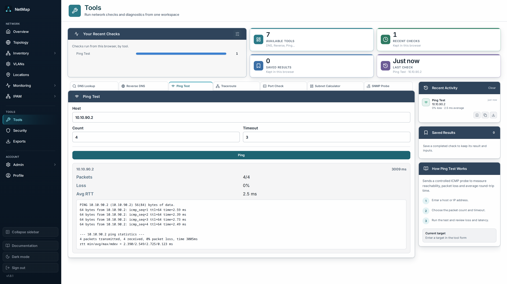

# Network Tools

The Tools workspace runs one-off network checks from the NetMap host. Passive tools need `tools_passive`, and active tools, which send traffic to the target, need `tools_active`. Each tool has a **How … Works** guide beside it.

<figure>
  <picture>
    <source srcset="../.gitbook/assets/screenshots/use-netmap/tools/tools-ping-dark.png" media="(prefers-color-scheme: dark)">
    
  </picture>
  <figcaption>A successful Ping Test to 10.10.90.2, the address of syd-core-sw-01.contoso.local.</figcaption>
</figure>

## Passive Tools

- **DNS Lookup** resolves a name and shows its A, AAAA, MX, TXT, NS or CNAME records.
- **Reverse DNS** looks up the PTR records for an IP address without probing the device. An empty answer is a valid result.
- **Subnet Calculator** shows a CIDR's network, mask, wildcard mask, usable range, broadcast address and host counts.

## Active Tools

- **Ping Test** measures reachability, packet loss and round-trip time.
- **Traceroute** traces the network path to a target. Routers and firewalls that suppress replies show up as `*` hops.
- **Port Check** tests whether a TCP or UDP service can be reached, with a protocol, port and timeout. UDP silence can mean filtered or simply no reply, and an open port does not prove the application is healthy.
- **SNMP Probe** queries an SNMP-enabled device with a saved SNMP profile or a manual community string. The profile list shows each profile's version (`v2c` or `v3`); a manual community is SNMPv2c only, so save an SNMPv3 profile to probe with SNMPv3. Profiles are managed on the [SNMP Profiles](../administer/snmp-profiles.md) tab in Admin.

By default, active tools only reach private targets. To allow public IP addresses and hostnames for ping, traceroute and port checks, an administrator turns on **Allow public active network targets** in **App Settings** on the [System](../administer/system.md) tab in Admin.

## Logs

The **Logs** tab shows NetMap's own recent log entries, so you can see what the server is doing without shell access to the container. It appears only for users with the `diagnostics_view` permission (Read system diagnostics).

- Filter by **Level**, **Source** (such as `monitors`, `discovery`, `snmp`, `auth` or `syslog`), **Text** in the message, logger or exception, and a **Since** and **Until** time. Times are shown in your browser's time zone.
- New entries appear automatically every few seconds. Select **Pause** to stop following them and **Resume** to continue.
- Select **Load older** to page back through earlier entries.
- Select a row that has an exception to expand it and read the stored traceback.

Entries include service start-up, monitor misses, monitor and device status changes, discovery and SNMP problems, and configuration changes. NetMap keeps them in memory only: the newest 5,000 by default, and the list starts empty after a restart. When older entries have been dropped to make room, the view shows **Some entries were dropped**. Passwords, tokens, keys, cookies and the password in a URL are replaced with `[REDACTED]` before an entry is stored.

For longer history, read the container log instead (see [Logging](../operations/logging.md)). Administrators can change how many entries are kept and the lowest level stored with the `APP_LOG_*` settings in the [Configuration Reference](../configuration/configuration.md).

## Recent Checks

The cards at the top show **Available tools**, **Recent checks**, **Saved Results** and **Last check**, which names the last tool and target. **Your Recent Checks** charts how many checks you have run with each tool.

The **Recent Activity** panel lists your latest checks; select one to reopen its inputs and result. For a successful check you can **Save result**, **Copy JSON** or **Export JSON**, and **Clear** empties the list. NetMap keeps up to 30 recent checks.

## Saved Results

**Saved Results** keeps up to 15 checks you chose to save, with their inputs. Select **Load inputs and result** to reopen one, **Export JSON** to download it, or **Remove** to delete it.

Recent and saved checks are kept only in this browser. They are not shared with other users or devices, and they do not replace Inventory or the audit history.

## Troubleshooting

| Symptom | Likely cause | Fix |
|---|---|---|
| A public target is refused | Public active targets are off | Test from an internal path, or ask an administrator to allow public targets |
| DNS returns no records | No answer, or the resolver failed | Check the record type and the resolver NetMap uses |
| Ping always fails | The container lacks raw-network capability, or ICMP is filtered | Check the image capabilities and test with **Port Check** |
| Traceroute has gaps | Routers or firewalls suppress replies | Treat `*` as unknown, not down |
| UDP result is unclear | The service did not reply | Use an application-level check where possible |
| SNMP probe fails | Wrong profile or community, an ACL, or a timeout | Check the credentials and the device's SNMP access |

## Related Pages

- [SNMP Profiles](../administer/snmp-profiles.md)
- [Network Exposure](../security/network-exposure.md)
