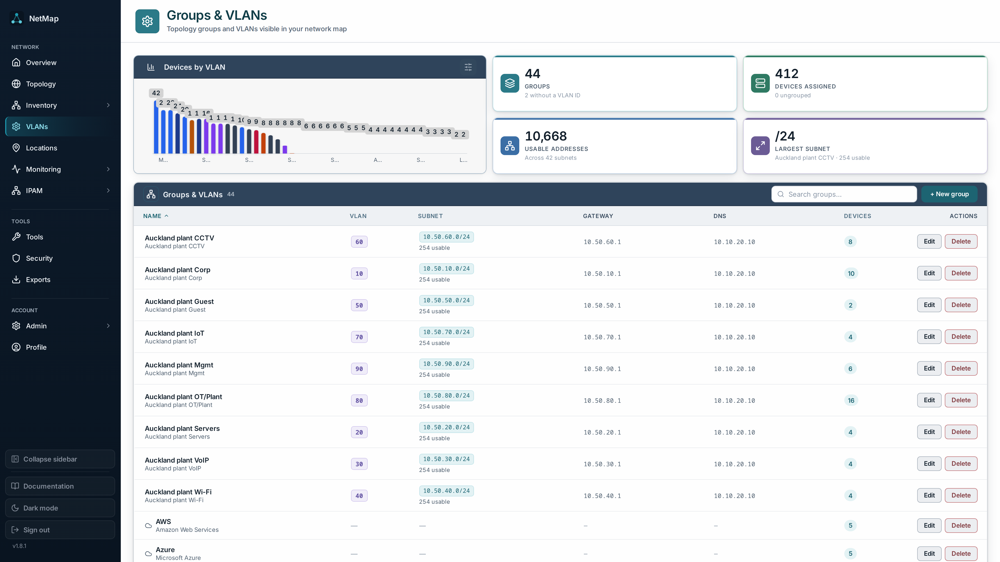

# VLANs And Groups

Groups organise your devices on the topology map and can carry VLAN and subnet details. Open **VLANs** in the sidebar; the page is titled **Groups & VLANs**. Anyone signed in can view it, and creating, editing or deleting groups needs `topology_write`.

<figure>
  <picture>
    <source srcset="../.gitbook/assets/screenshots/use-netmap/vlans/vlans-groups-dark.png" media="(prefers-color-scheme: dark)">
    
  </picture>
  <figcaption>The VLANs and groups workspace for Contoso Ltd.</figcaption>
</figure>

## The Groups & VLANs Page

**Devices by VLAN** is a column chart of how many devices each group or VLAN holds, largest first. Each column is labelled with the group's display name and VLAN ID and uses the group's colour. Select a column to open IPAM with that group's subnet selected; NetMap matches the subnet by CIDR first, then by VLAN ID.

Beside the chart are four cards:

- **Groups**, with how many lack a VLAN ID;
- **Devices assigned**, with how many devices are ungrouped;
- **Usable addresses**, summed across every group subnet;
- **Largest subnet**, with its group and usable address count.

## Find A Group

Search with **Search groups…** to match names, display names, VLAN IDs, subnets, gateways, DNS servers or descriptions. The table shows **Name**, **VLAN**, **Subnet** (with its usable address count), **Gateway**, **DNS** and **Devices**, and you can sort by name, VLAN, subnet or devices.

Rows marked **inferred** come from group labels on devices that have no saved group yet. Drag a column divider to resize it, double-click a divider to reset all columns, or use **Reset columns**.

## Create Or Edit A Group

1. Select **+ New group**, or **Edit** on a row.
2. Choose a **Type**: **Network** (the default) or **Cloud**.
3. Enter a **Name**. For a network group, **Display name**, **VLAN ID**, **Subnet (CIDR)**, **Gateway**, **DNS servers** and **Description** are optional. For a cloud group, **Display name**, **Provider** (for example AWS) and **Description** are optional.
4. Select **Create group** or **Save changes**.

### Cloud Groups

Use a cloud group for assets that do not share one IP range, such as instances spread across a cloud provider. A cloud group cannot carry a VLAN ID, subnet or DHCP range, so it is left out of the subnet totals and **Import from VLANs**. It shows a cloud icon in the group list and a dashed outline on the [topology map](./topology.md), and discovery import never sets a scan target on it.

Editing an inferred row opens a new group prefilled with its name. Group colours are set in Admin under [Devices And Icons](../administer/devices-and-icons.md).

## Assign Devices

Assign devices to a group from Inventory, the device details window, Topology bulk selection or discovery. See [Inventory](./inventory.md#columns-and-selection) for bulk assignment.

## Delete A Group

Select **Delete** on a row and confirm with **Delete group**. Devices are not deleted, but their group assignment is cleared, so review the assigned devices and any matching IPAM subnets first.

## Use Groups In IPAM

In IPAM, **Import from VLANs** offers every group with a valid subnet as a new subnet, and marks those already imported. See [IPAM](./ipam.md#vlan-suggestions-and-performance).

## Troubleshooting

| Symptom | Likely cause | Fix |
|---|---|---|
| You cannot save a group | Your role lacks `topology_write` | Ask a SuperAdmin to update your role |
| A group is missing from **Import from VLANs** | The group has no valid subnet | Add a CIDR in **Subnet (CIDR)** and try again |
| A device appears ungrouped | It has no group assignment | Assign it from Inventory, device details or Topology |
| Selecting a column opens IPAM with nothing selected | No IPAM subnet matches the group's CIDR or VLAN ID | Import or create the subnet in IPAM |

## Use The API

- `GET /api/v1/topology/groups`
- `POST /api/v1/topology/groups`
- `PATCH /api/v1/topology/groups/{group_id}`
- `DELETE /api/v1/topology/groups/{group_id}`
- `POST /api/v1/topology/groups/reset-device-assignments` clears the group assignment of every device; the web app does not offer this action.

## Related Pages

- [IPAM](./ipam.md)
- [Topology](./topology.md)
- [Inventory](./inventory.md)
